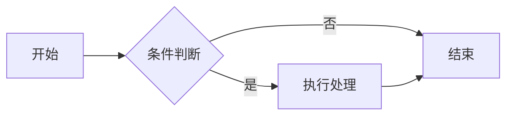

# 代码块语言

在代码块开头的反引号后写语言标识，可获得对应的语法高亮；部分特殊语言会被渲染为图表、公式或画布。

## 语法高亮语言

以下语言由 highlight.js 提供语法高亮（内置常用集）：

| 分类 | 语言标识 |
| --- | --- |
| 前端 | `javascript` `js`、`typescript` `ts`、`xml` / `html`、`css`、`less`、`scss` |
| 后端 | `java`、`python` `py`、`go`、`rust`、`c`、`cpp`、`csharp` `cs`、`php`、`kotlin`、`swift`、`ruby`、`lua`、`perl`、`objectivec`、`r`、`vbnet` |
| 脚本与标记 | `bash` / `shell`、`makefile`、`markdown` `md`、`yaml` `yml`、`ini` / `toml`、`diff`、`graphql` |
| 数据 | `json`、`sql`、`wasm` |

> 未写语言标识或写成 `text` / `plaintext` 时按纯文本显示，不做高亮。

## 特殊代码块（渲染增强）

以下语言标识不会按普通代码显示，而是渲染为对应的可视化内容：

| 语言标识 | 渲染效果 |
| --- | --- |
| `mermaid` | Mermaid 图表（流程图 / 时序图 / 甘特图等） |
| `sequence` | 时序图（Mermaid sequenceDiagram 的简写） |
| `chart` / `chartjs` | Chart.js 数据图表 |
| `plantuml` / `puml` | PlantUML 图（需在设置中配置渲染服务） |
| `math` / `mathjax` | KaTeX 块级数学公式 |
| `whiteboard` / `excalidraw` | 只读 Excalidraw 白板画布 |

## Mermaid 示例

````markdown

````

上面的示例实际渲染效果：


## Chart 示例

`chart` 代码块内写 Chart.js 的 JSON 配置（`type` + `data` + 可选 `options`）：

````markdown
```chart
{
  "type": "bar",
  "data": {
    "labels": ["一月", "二月", "三月", "四月"],
    "datasets": [{ "label": "示例数据", "data": [12, 19, 8, 15] }]
  }
}
```
````

上面的示例实际渲染效果：

```chart
{
  "type": "bar",
  "data": {
    "labels": ["一月", "二月", "三月", "四月"],
    "datasets": [{ "label": "示例数据", "data": [12, 19, 8, 15] }]
  }
}
```

也支持简化格式（自动配色）：

````markdown
```chart
{
  "type": "pie",
  "title": "水果占比",
  "data": [
    { "name": "苹果", "value": 40 },
    { "name": "香蕉", "value": 35 },
    { "name": "橘子", "value": 25 }
  ]
}
```
````

## Whiteboard 示例

`whiteboard` 代码块内容为 Excalidraw 的场景 JSON，或第一行为相对文件路径引用外部 `.board` / `.excalidraw` 文件：

````markdown
```whiteboard
{"type":"excalidraw","version":2,"elements":[],"appState":{"viewBackgroundColor":"#ffffff"}}
```
````
